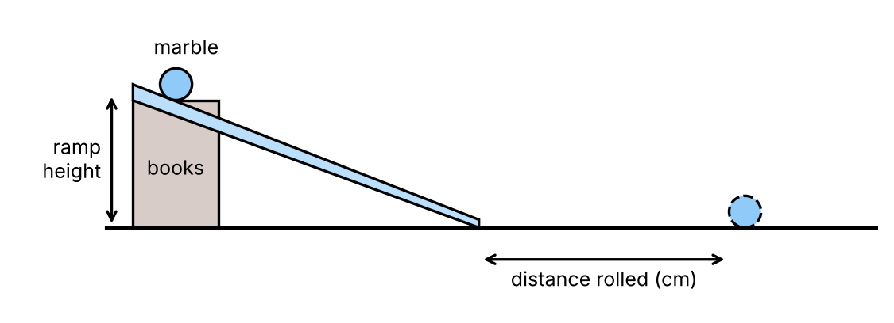

================================================
1–2. The Investigation and the Energy Science
================================================

1. The practice investigation at a glance
------------------------------------------------

**Research question:** "How does the height of a ramp affect the distance a marble rolls along the floor?"

    A marble is released from the top of a ramp and rolls along the floor.

.. admonition:: Key ideas
    :class: note

    * A marble is **released** (not pushed) from the top of a ramp.
    * The ramp is raised to heights of **5, 10, 15 and 20 cm** using books.
    * The distance the marble rolls **along the floor from the end of the ramp** is measured with a measuring tape.
    * Each height is tested **three times** (three trials) and an **average** is calculated.
    * We cannot easily measure the marble's kinetic energy directly, so we measure **distance rolled** instead. More kinetic energy = the marble rolls further.
    * Under controlled conditions, the **true (accepted) values** are 30, 60, 90 and 120 cm for ramp heights of 5, 10, 15 and 20 cm.

.. list-table::
   :widths: 30 30 40
   :header-rows: 1

   * - Ramp height (cm)
     - True distance (cm)
     - Pattern
   * - 5
     - 30
     - —
   * - 10
     - 60
     - +30 cm
   * - 15
     - 90
     - +30 cm
   * - 20
     - 120
     - +30 cm

*Each extra 5 cm of height adds the same extra distance (30 cm), so the true results form a straight line. Doubling the height doubles the distance.*

Fill in the gaps
~~~~~~~~~~~~~~~~~~~~~~

.. cloze::
    :instructions: Drag each word from the word bank into the correct gap. Each word is used once.

    1. In this practical, a marble is @@released@@ from the top of a ramp without being pushed.
    2. The distance the marble rolls is measured from the @@end@@ of the ramp.
    3. Each ramp height is tested three times, and an @@average@@ is calculated.
    4. Distance rolled is measured because kinetic energy is hard to measure @@directly@@.
    5. The true values show that doubling the ramp height @@doubles@@ the distance rolled.

Check your understanding
~~~~~~~~~~~~~~~~~~~~~~~~~~

.. mcqgroup::
    :show-instant-feedback:
    :shuffle-questions:
    :num-questions: 5

    .. multichoice::

        What is the research question for the marble investigation?

        [x] How does the height of a ramp affect the distance a marble rolls along the floor? | Correct. It links the ramp height to the distance rolled.
        [ ] How does the mass of a marble affect its speed? | Incorrect. The same marble is used every time, so mass is not being tested.
        [ ] How does the floor surface affect the distance a marble rolls? | Incorrect. The floor surface is kept the same.
        [ ] How long does a marble take to roll down a ramp? | Incorrect. Time is not measured in this investigation.

    .. multichoice::

        How is the marble started at the top of the ramp?

        [x] It is released without being pushed. | Correct. A push would give the marble extra energy.
        [ ] It is pushed gently with a finger. | Incorrect. A push adds extra kinetic energy and changes the results.
        [ ] It is thrown onto the ramp. | Incorrect. This would add a large, uncontrolled amount of energy.
        [ ] It is flicked with a ruler. | Incorrect. Flicking is a type of push.

    .. multichoice::

        Which ramp heights are tested in the investigation?

        [x] 5, 10, 15 and 20 cm | Correct. The height goes up in even steps of 5 cm.
        [ ] 30, 60, 90 and 120 cm | Incorrect. These are the true distances rolled, not the heights.
        [ ] 1, 2, 3 and 4 cm | Incorrect. These are not the heights used.
        [ ] 5, 10, 20 and 50 cm | Incorrect. These steps are uneven.

    .. multichoice::

        How many times is each ramp height tested?

        [x] Three times | Correct. Three trials are done and an average is calculated.
        [ ] Once | Incorrect. One trial cannot show whether a result is an outlier.
        [ ] Twice | Incorrect. The practical uses three trials.
        [ ] Ten times | Incorrect. The practical uses three trials.

    .. multichoice::

        Why is the distance rolled measured instead of the marble's kinetic energy?

        [x] Kinetic energy is hard to measure directly, but more kinetic energy makes the marble roll further. | Correct. Distance rolled is a measurable sign of the kinetic energy.
        [ ] Distance and kinetic energy are not related. | Incorrect. More kinetic energy means the marble rolls further.
        [ ] Kinetic energy is always zero for a marble. | Incorrect. A moving marble has kinetic energy.
        [ ] Distance is the independent variable. | Incorrect. Distance is the dependent variable.

    .. multichoice::

        Where is the distance rolled measured from?

        [x] The end of the ramp | Correct. It is measured from the end of the ramp to where the marble stops.
        [ ] The top of the ramp | Incorrect. That would include the length of the ramp.
        [ ] The stack of books | Incorrect. That adds extra distance every time.
        [ ] The wall of the classroom | Incorrect. This is not a consistent starting point linked to the ramp.

    .. multichoice::

        What is the true (accepted) distance for a ramp height of 15 cm?

        [x] 90 cm | Correct. The true values are 30, 60, 90 and 120 cm.
        [ ] 60 cm | Incorrect. 60 cm is the true value for 10 cm.
        [ ] 120 cm | Incorrect. 120 cm is the true value for 20 cm.
        [ ] 45 cm | Incorrect. Each 5 cm of height adds 30 cm.

    .. multichoice::

        In the true values, how much extra distance does each extra 5 cm of ramp height add?

        [x] 30 cm | Correct. The distance goes 30, 60, 90, 120 cm.
        [ ] 5 cm | Incorrect. 5 cm is the change in height, not distance.
        [ ] 15 cm | Incorrect. Look at the gap between the true distances.
        [ ] 60 cm | Incorrect. 60 cm is the true distance at 10 cm.

    .. multichoice::
        :torf:

        In the true values, doubling the ramp height doubles the distance the marble rolls.

        [x] True | Correct. For example, 5 cm gives 30 cm and 10 cm gives 60 cm.
        [ ] False | Incorrect. 5 cm → 30 cm and 10 cm → 60 cm, so doubling the height doubles the distance.

    .. multichoice::

        Which piece of equipment is used to measure the distance the marble rolls?

        [x] Measuring tape | Correct. A measuring tape measures distances along the floor.
        [ ] Stopwatch | Incorrect. A stopwatch measures time.
        [ ] Thermometer | Incorrect. A thermometer measures temperature.
        [ ] Electronic balance | Incorrect. A balance measures mass.

2. The energy science behind the investigation
------------------------------------------------

.. admonition:: Key ideas
    :class: note

    * **Energy** is the ability to cause change or make things happen. It can be **transferred** (moved to another object) or **transformed** (changed into another form).
    * **Gravitational potential energy (GPE)** is stored energy an object has because it is raised above the ground. **The higher the object, the more GPE it has.**
    * **Kinetic energy (KE)** is the energy of movement. A still marble has no KE; a slow marble has some KE; a fast marble has more KE.
    * As the marble rolls down the ramp, **GPE is transformed into KE**. A higher ramp → more GPE at the top → more KE at the bottom → the marble rolls further.
    * The marble eventually stops because **friction** and **air resistance** transform its KE into **heat and sound** (waste energy). The energy is not destroyed (Law of Conservation of Energy).

**Marble at top of ramp: gravitational potential energy → kinetic energy → heat + sound (as it slows to a stop)**

.. admonition:: Applying the science: a rougher ramp
    :class: hint

    If the ramp is covered in **sandpaper or carpet**, there is more **friction** between the marble and the ramp.
    More of the marble's energy is transformed into **heat and sound** (waste energy) on the way down, so it has **less kinetic energy** at the bottom.

    **Prediction:** the marble would roll a **shorter distance** than on the smooth ramp from the same height.

Fill in the gaps
~~~~~~~~~~~~~~~~~~~~~~

.. cloze::
    :instructions: Drag each word from the word bank into the correct gap. Each word is used once.

    1. A raised object has @@gravitational@@ potential energy.
    2. The higher the ramp, the @@more@@ potential energy the marble has at the top.
    3. As the marble rolls down the ramp, potential energy is transformed into @@kinetic@@ energy.
    4. @@Friction@@ slows the marble down and transforms its energy into heat and sound.
    5. On a rougher ramp, the marble would roll a @@shorter@@ distance.

Check your understanding
~~~~~~~~~~~~~~~~~~~~~~~~~~

.. mcqgroup::
    :show-instant-feedback:
    :shuffle-questions:
    :num-questions: 5

    .. multichoice::

        What is energy?

        [x] The ability to cause change or make things happen | Correct.
        [ ] A type of force that pushes objects | Incorrect. Energy and force are different things.
        [ ] The speed of an object | Incorrect. Speed is linked to kinetic energy but is not energy itself.
        [ ] The mass of an object | Incorrect. Mass is measured in kilograms, not energy units.

    .. multichoice::

        What is gravitational potential energy (GPE)?

        [x] Stored energy an object has because it is raised above the ground | Correct. The higher the object, the more GPE it has.
        [ ] The energy of a moving object | Incorrect. That is kinetic energy.
        [ ] Energy given off as heat | Incorrect. That is thermal (heat) energy.
        [ ] Energy stored in a stretched rubber band | Incorrect. That is elastic potential energy.

    .. multichoice::

        What is kinetic energy (KE)?

        [x] The energy of movement | Correct. A faster marble has more KE.
        [ ] Stored energy due to height | Incorrect. That is gravitational potential energy.
        [ ] Energy stored in food | Incorrect. That is chemical energy.
        [ ] Energy that has been destroyed | Incorrect. Energy cannot be destroyed.

    .. multichoice::

        Which energy transformation happens as the marble rolls down the ramp?

        [x] Gravitational potential energy → kinetic energy | Correct. Stored energy from height becomes movement energy.
        [ ] Kinetic energy → gravitational potential energy | Incorrect. That happens when an object moves upwards.
        [ ] Sound energy → kinetic energy | Incorrect. The marble does not get its movement from sound.
        [ ] Heat energy → gravitational potential energy | Incorrect. This is the wrong direction and the wrong forms.

    .. multichoice::

        Why does a marble released from a higher ramp roll further?

        [x] It starts with more GPE, which is transformed into more KE by the bottom of the ramp. | Correct. More KE means it travels further before stopping.
        [ ] It has less friction at the bottom. | Incorrect. The floor surface is the same for every height.
        [ ] A higher ramp makes the marble heavier. | Incorrect. The marble's mass does not change.
        [ ] It has less GPE at the top. | Incorrect. A higher ramp gives more GPE.

    .. multichoice::

        Why does the marble eventually stop rolling along the floor?

        [x] Friction and air resistance transform its KE into heat and sound. | Correct. The energy is transformed into waste energy.
        [ ] It runs out of mass. | Incorrect. The marble's mass does not change.
        [ ] Its energy is destroyed. | Incorrect. Energy cannot be destroyed.
        [ ] Gravity pushes it backwards. | Incorrect. On a flat floor, friction and air resistance slow it down.

    .. multichoice::
        :torf:

        When the marble stops rolling, its energy has been destroyed.

        [ ] True | Incorrect. The Law of Conservation of Energy says energy cannot be destroyed. It has been transformed into heat and sound.
        [x] False | Correct. The energy has been transformed into heat and sound, not destroyed.

    .. multichoice::

        What does it mean when energy is transformed?

        [x] It is changed into another form. | Correct. For example, GPE is transformed into KE.
        [ ] It is moved to another object. | Incorrect. That is a transfer.
        [ ] It is destroyed. | Incorrect. Energy cannot be destroyed.
        [ ] It is created from nothing. | Incorrect. Energy cannot be created.

    .. multichoice::

        The ramp is covered in sandpaper. What happens to the distance the marble rolls from the same height?

        [x] It rolls a shorter distance, because more friction transforms more energy into heat and sound. | Correct. Less KE is left at the bottom of the ramp.
        [ ] It rolls further, because sandpaper gives it more grip. | Incorrect. More friction means more energy is wasted.
        [ ] It rolls the same distance, because the height is the same. | Incorrect. The extra friction changes how much KE is left.
        [ ] It rolls further, because it gains GPE on the sandpaper. | Incorrect. GPE depends on height, not the surface.

    .. multichoice::

        Which marble has the most kinetic energy?

        [x] A marble moving fast | Correct. The faster it moves, the more KE it has.
        [ ] A marble moving slowly | Incorrect. It has some KE, but less than a fast marble.
        [ ] A marble sitting still at the top of the ramp | Incorrect. A still marble has no KE (but it has GPE).
        [ ] A marble that has stopped on the floor | Incorrect. A still marble has no KE.
