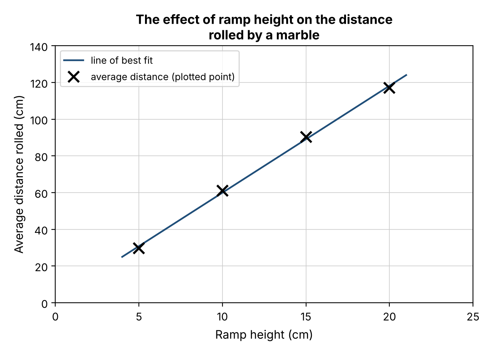

================================================
9–11. Results, Graphs and Trends
================================================

9. Recording results and calculating averages
------------------------------------------------

.. admonition:: Key ideas
    :class: note

    * Results tables have the **IV in the first column** and the **DV** (each trial, then the average) in the next columns.
    * Put **units in the column headings**, e.g. Height (cm), not after every number.
    * **Average (mean)** = add up the trial results ÷ the number of trials.
    * Round averages sensibly, usually to **one decimal place**.

.. list-table::
   :widths: 20 20 20 20 20
   :header-rows: 1

   * - Height (cm)
     - Trial 1 (cm)
     - Trial 2 (cm)
     - Trial 3 (cm)
     - Average (cm)
   * - 5
     - 28
     - 31
     - 30
     - 29.7
   * - 10
     - 58
     - 64
     - 61
     - 61.0
   * - 15
     - 89
     - 92
     - 90
     - 90.3
   * - 20
     - 118
     - 124
     - 109
     - 117.0

.. admonition:: Worked examples
    :class: hint

    | 5 cm: (28 + 31 + 30) ÷ 3 = 89 ÷ 3 = **29.7 cm**
    | 10 cm: (58 + 64 + 61) ÷ 3 = 183 ÷ 3 = **61.0 cm**
    | 15 cm: (89 + 92 + 90) ÷ 3 = 271 ÷ 3 = **90.3 cm**
    | 20 cm: (118 + 124 + 109) ÷ 3 = 351 ÷ 3 = **117.0 cm**

.. admonition:: Watch out
    :class: warning

    Add all three trials **before** dividing by 3. Use brackets on your calculator.
    Check that your average sits **between** the smallest and largest trial value. If it doesn't, you have made a mistake.

Fill in the gaps
~~~~~~~~~~~~~~~~~~~~~~

.. cloze::
    :instructions: Drag each word from the word bank into the correct gap. Each word is used once.

    1. The independent variable goes in the @@first@@ column of a results table.
    2. @@Units@@ are written in the column headings.
    3. To find the average, add the trial results and @@divide@@ by the number of trials.
    4. Averages are usually rounded to one @@decimal@@ place.
    5. An average must sit between the smallest and @@largest@@ trial value.

Check your understanding
~~~~~~~~~~~~~~~~~~~~~~~~~~

.. mcqgroup::
    :show-instant-feedback:
    :shuffle-questions:
    :num-questions: 5

    .. multichoice::

        Which column of a results table should the independent variable go in?

        [x] The first column | Correct.
        [ ] The last column | Incorrect. The average (DV) usually goes last.
        [ ] The middle column | Incorrect. The trials go in the middle.
        [ ] It should not be in the table | Incorrect. The IV must be shown.

    .. multichoice::

        Where should units be written in a results table?

        [x] In the column headings | Correct. For example, Height (cm).
        [ ] After every number | Incorrect. This clutters the table.
        [ ] Below the table | Incorrect. They belong in the headings.
        [ ] Units are not needed | Incorrect. Units are always needed.

    .. multichoice::

        How is an average (mean) calculated?

        [x] Add up the trial results, then divide by the number of trials | Correct.
        [ ] Subtract the smallest result from the largest | Incorrect. That gives the range.
        [ ] Pick the middle result | Incorrect. That is the median, not the mean.
        [ ] Multiply all the results together | Incorrect. This is not how an average is found.

    .. multichoice::

        What is the average of 28 cm, 31 cm and 30 cm?

        [x] 29.7 cm | Correct. 89 ÷ 3 = 29.7 cm.
        [ ] 89.0 cm | Incorrect. That is the total; you still need to divide by 3.
        [ ] 30.0 cm | Incorrect. Check the division: 89 ÷ 3.
        [ ] 3.0 cm | Incorrect. That is the range.

    .. multichoice::

        What is the average of 89 cm, 92 cm and 90 cm?

        [x] 90.3 cm | Correct. 271 ÷ 3 = 90.3 cm.
        [ ] 271.0 cm | Incorrect. That is the total.
        [ ] 91.0 cm | Incorrect. Check the division: 271 ÷ 3.
        [ ] 90.0 cm | Incorrect. That is the true value, not the average.

    .. multichoice::

        How many decimal places are averages usually rounded to?

        [x] One | Correct. For example, 29.7 cm.
        [ ] None | Incorrect. One decimal place is usual.
        [ ] Three | Incorrect. This is more than needed.
        [ ] Five | Incorrect. This is far more than needed.

    .. multichoice::

        Where must an average always sit?

        [x] Between the smallest and largest trial value | Correct. If not, there is a mistake.
        [ ] Above the largest trial value | Incorrect. An average cannot be bigger than all the trials.
        [ ] Below the smallest trial value | Incorrect. An average cannot be smaller than all the trials.
        [ ] Exactly on the true value | Incorrect. It may be close to it, but not always equal.

    .. multichoice::

        A student types 118 + 124 + 109 ÷ 3 into a calculator and gets 278.3 cm. What went wrong?

        [x] Only 109 was divided by 3; brackets were needed around the total. | Correct. (118 + 124 + 109) ÷ 3 = 117.0 cm.
        [ ] They should have divided by 4. | Incorrect. There are three trials.
        [ ] 278.3 cm is the correct average. | Incorrect. It is bigger than every trial value.
        [ ] They should have multiplied by 3. | Incorrect. The total is divided by 3.

    .. multichoice::

        Which is the correct way to write a column heading for the IV?

        [x] Height (cm) | Correct. It names the variable and gives the unit.
        [ ] Height | Incorrect. The unit is missing.
        [ ] cm | Incorrect. The variable name is missing.
        [ ] 5 cm | Incorrect. This is a value, not a heading.

    .. multichoice::

        What is the average distance rolled at the 20 cm height?

        [x] 117.0 cm | Correct. 351 ÷ 3 = 117.0 cm.
        [ ] 120.0 cm | Incorrect. That is the true value.
        [ ] 351.0 cm | Incorrect. That is the total of the three trials.
        [ ] 124.0 cm | Incorrect. That is the largest trial.

10. Drawing a line graph
------------------------------------------------

.. admonition:: Key ideas
    :class: note

    * Use a **line graph** when both variables are numbers that can take any value (continuous), like height and distance.
    * **IV on the x-axis** (horizontal) and **DV on the y-axis** (vertical).
    * **Title:** "The effect of [IV] on [DV]".
    * **Axis labels with units**, e.g. Ramp height (cm) and Average distance rolled (cm).
    * **Even scales**: each grid square must be worth the same amount. Start at 0 and make the graph fill most of the paper.
    * Plot each **average** as a neat cross (×) in pencil, then draw a **line of best fit** with a ruler.

    Model graph of the average results.

.. admonition:: Watch out
    :class: warning

    * A **line of best fit** is ONE smooth straight line (or curve) that passes as close as possible to all the points, with about the same number of points on each side. **Do not join the dots.**
    * Graph the **averages**, not every trial.
    * Uneven scales (e.g. 0, 10, 20, 50, 100) are a very common way to lose marks.

Fill in the gaps
~~~~~~~~~~~~~~~~~~~~~~

.. cloze::
    :instructions: Drag each word from the word bank into the correct gap. Each word is used once.

    1. A @@line@@ graph is used when both variables are continuous numbers.
    2. The independent variable goes on the @@x-axis@@.
    3. Each axis needs a label and @@units@@.
    4. Scales must be @@even@@, with each square worth the same amount.
    5. A line of best @@fit@@ passes close to all the points without joining the dots.

Check your understanding
~~~~~~~~~~~~~~~~~~~~~~~~~~

.. mcqgroup::
    :show-instant-feedback:
    :shuffle-questions:
    :num-questions: 5

    .. multichoice::

        When should a line graph be used?

        [x] When both variables are continuous numbers | Correct. For example, height and distance.
        [ ] When the IV is a category, such as type of floor | Incorrect. A column graph suits categories.
        [ ] When there are no numbers | Incorrect. Graphs need numerical data.
        [ ] Only when there is one trial | Incorrect. The number of trials does not decide the graph type.

    .. multichoice::

        Which axis does the independent variable go on?

        [x] The x-axis (horizontal) | Correct.
        [ ] The y-axis (vertical) | Incorrect. The DV goes on the y-axis.
        [ ] Either axis | Incorrect. The IV always goes on the x-axis.
        [ ] It goes in the title only | Incorrect. It must be on an axis.

    .. multichoice::

        Which axis does the dependent variable go on?

        [x] The y-axis (vertical) | Correct.
        [ ] The x-axis (horizontal) | Incorrect. The IV goes on the x-axis.
        [ ] Neither axis | Incorrect. The DV must be graphed.
        [ ] Both axes | Incorrect. Each axis shows a different variable.

    .. multichoice::

        Which is the best title for the marble graph?

        [x] The effect of ramp height on the distance rolled by a marble | Correct. It follows "The effect of [IV] on [DV]".
        [ ] Marble graph | Incorrect. It does not name the variables.
        [ ] Distance | Incorrect. It does not name the IV.
        [ ] My results | Incorrect. It does not name the variables.

    .. multichoice::

        Which is the best x-axis label for the marble graph?

        [x] Ramp height (cm) | Correct. It names the variable and gives the unit.
        [ ] Height | Incorrect. The unit is missing.
        [ ] cm | Incorrect. The variable name is missing.
        [ ] Average distance rolled (cm) | Incorrect. That is the y-axis label.

    .. multichoice::

        Which of these is an even scale?

        [x] 0, 20, 40, 60, 80 | Correct. Each step is worth the same amount.
        [ ] 0, 10, 20, 50, 100 | Incorrect. The steps are uneven.
        [ ] 0, 5, 20, 25, 60 | Incorrect. The steps are uneven.
        [ ] 29.7, 61.0, 90.3, 117.0 | Incorrect. These are data values, not an even scale.

    .. multichoice::

        Which values should be plotted on the graph?

        [x] The averages for each height | Correct.
        [ ] Every individual trial | Incorrect. Plot the averages.
        [ ] Only the largest trial at each height | Incorrect. This ignores the other trials.
        [ ] The true values only | Incorrect. You graph your own results.

    .. multichoice::

        What is a line of best fit?

        [x] One smooth line that passes as close as possible to all the points, with about the same number on each side | Correct.
        [ ] A line that joins each point to the next | Incorrect. Do not join the dots.
        [ ] A line from the first point to the last point only | Incorrect. It must fit all the points.
        [ ] A line drawn along the x-axis | Incorrect. It must follow the pattern of the points.

    .. multichoice::
        :torf:

        You should join the dots on a line graph with a ruler.

        [ ] True | Incorrect. Draw a single line of best fit instead.
        [x] False | Correct. Do not join the dots; draw one line of best fit.

    .. multichoice::

        How should each average be plotted?

        [x] As a neat cross (×) in pencil | Correct.
        [ ] As a large coloured blob | Incorrect. This makes the position unclear.
        [ ] As a bar | Incorrect. Bars are for column graphs.
        [ ] In pen so it can't be rubbed out | Incorrect. Use pencil so mistakes can be fixed.

11. Describing trends and patterns
------------------------------------------------

.. admonition:: Key ideas
    :class: note

    * A **trend** describes how the DV changes as the IV changes: does it increase, decrease or stay the same?
    * A full answer includes: **(1)** a statement about the IV, **(2)** a statement about the DV and its direction, and **(3)** **data** from the table or graph as evidence (with units).

.. admonition:: Sentence starter
    :class: tip

    *As the [IV] increased from ___ to ___, the [DV] [increased/decreased] from ___ to ___.*

.. admonition:: In the marble investigation
    :class: hint

    As the ramp height increased from 5 cm to 20 cm, the average distance rolled by the marble increased from 29.7 cm to 117.0 cm.
    Each 5 cm increase in height added roughly 30 cm to the distance, so the points form a straight line (a **positive, linear** relationship).
    Doubling the height from 5 cm to 10 cm roughly doubled the distance (29.7 cm to 61.0 cm).

Fill in the gaps
~~~~~~~~~~~~~~~~~~~~~~

.. cloze::
    :instructions: Drag each word from the word bank into the correct gap. Each word is used once.

    1. A @@trend@@ describes how the DV changes as the IV changes.
    2. As the ramp height increased, the distance rolled @@increased@@.
    3. You must use @@data@@ from the table or graph to support your answer.
    4. The points form a straight line, so the relationship is @@linear@@.

Check your understanding
~~~~~~~~~~~~~~~~~~~~~~~~~~

.. mcqgroup::
    :show-instant-feedback:
    :shuffle-questions:
    :num-questions: 5

    .. multichoice::

        What does a trend describe?

        [x] How the DV changes as the IV changes | Correct.
        [ ] How safe the experiment was | Incorrect. That is a risk assessment.
        [ ] The equipment used | Incorrect. That is the materials list.
        [ ] What the experiment is trying to find out | Incorrect. That is the aim.

    .. multichoice::

        What three things does a full trend description include?

        [x] A statement about the IV, a statement about the DV and its direction, and data with units | Correct.
        [ ] A hazard, a risk and a control measure | Incorrect. Those belong in a risk assessment.
        [ ] The title, the axes and the scale | Incorrect. Those are parts of a graph.
        [ ] The aim, the method and the materials | Incorrect. Those are planning sections.

    .. multichoice::

        Which is the best description of the trend in the marble results?

        [x] As the ramp height increased from 5 cm to 20 cm, the average distance rolled increased from 29.7 cm to 117.0 cm. | Correct. It names the IV, the DV, the direction and gives data.
        [ ] The marble went further. | Incorrect. No IV and no data.
        [ ] As the ramp height increased, the distance increased. | Incorrect. It has no data.
        [ ] The results were good. | Incorrect. This does not describe a trend.

    .. multichoice::

        What type of relationship do the marble results show?

        [x] Positive and linear | Correct. Distance increases with height and the points form a straight line.
        [ ] Negative and linear | Incorrect. Distance increases, so it is positive.
        [ ] No relationship | Incorrect. There is a clear pattern.
        [ ] Positive and curved | Incorrect. The points form a straight line.

    .. multichoice::

        Roughly how much does each 5 cm increase in height add to the distance rolled?

        [x] About 30 cm | Correct.
        [ ] About 5 cm | Incorrect. 5 cm is the change in height.
        [ ] About 60 cm | Incorrect. Look at the differences between the averages.
        [ ] Nothing | Incorrect. The distance increases each time.

    .. multichoice::

        What happened to the distance when the height doubled from 5 cm to 10 cm?

        [x] It roughly doubled, from 29.7 cm to 61.0 cm. | Correct.
        [ ] It halved. | Incorrect. It increased.
        [ ] It stayed the same. | Incorrect. It increased.
        [ ] It tripled. | Incorrect. 29.7 cm to 61.0 cm is roughly double.

    .. multichoice::

        What is missing from this answer? "As the ramp height increased, the distance rolled increased."

        [x] Data from the table or graph, with units | Correct.
        [ ] A statement about the IV | Incorrect. The ramp height is mentioned.
        [ ] A direction word | Incorrect. "Increased" is a direction word.
        [ ] A statement about the DV | Incorrect. Distance rolled is mentioned.

    .. multichoice::

        What does a positive relationship mean?

        [x] As the IV increases, the DV increases. | Correct.
        [ ] As the IV increases, the DV decreases. | Incorrect. That is a negative relationship.
        [ ] The results are accurate. | Incorrect. That is about accuracy, not the relationship.
        [ ] The hypothesis was proven. | Incorrect. Hypotheses are never proven.

    .. multichoice::

        Using the straight-line pattern, what distance would you predict for a ramp height of 12.5 cm?

        [x] About 75 cm | Correct. It sits halfway between 60 cm (10 cm) and 90 cm (15 cm).
        [ ] About 12.5 cm | Incorrect. That is the height, not the distance.
        [ ] About 120 cm | Incorrect. That is the distance at 20 cm.
        [ ] About 40 cm | Incorrect. That is too low for a height between 10 cm and 15 cm.

    .. multichoice::
        :torf:

        A linear relationship means the points form a straight line.

        [x] True | Correct.
        [ ] False | Incorrect. Linear means the points lie along a straight line.
