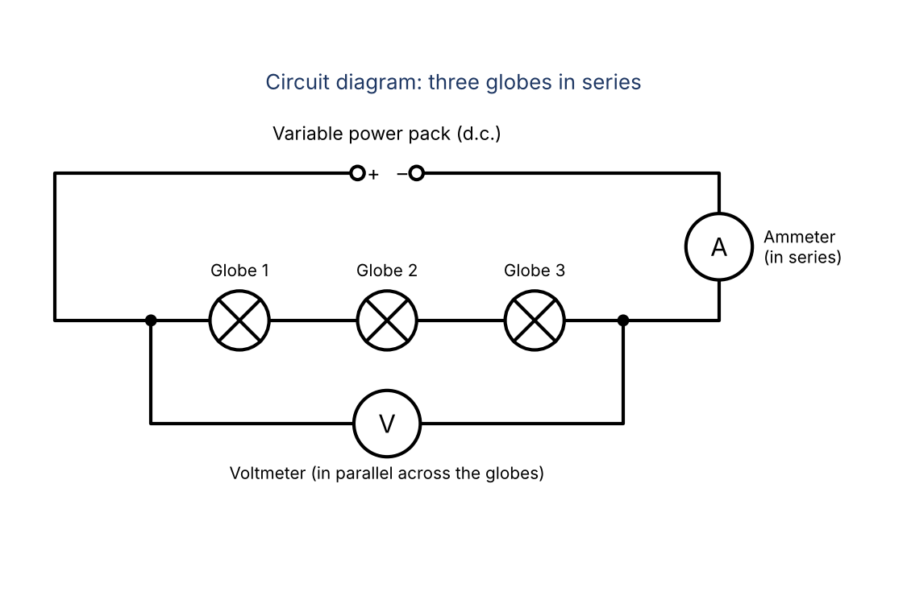

================================================
Step 3. Safety, Circuit Diagram and Method
================================================

Part A: Practical Design

Question 5: Safety
------------------------------------------------

.. admonition:: Question 5 (2 marks)
    :class: important

    Outline two safety considerations for this investigation.

.. admonition:: Key ideas
    :class: note

    * A **hazard** is the thing that could cause harm.
    * A **risk** is the harm that the hazard could cause.
    * A **safety precaution** is what you do to reduce the risk.

.. list-table::
   :widths: 25 35 40
   :header-rows: 1

   * - Hazard
     - Risk
     - Safety precaution
   * - Hot light globes
     - Burns to the skin if a globe is touched
     - Switch off the power pack and let the globes cool before touching or adding globes
   * - Electricity from the power pack
     - Electric shock, or overheated leads from a short circuit
     - Switch off the power pack before changing the circuit, and keep hands and benches dry

Fill in the gaps
~~~~~~~~~~~~~~~~~~~~~~

.. cloze::
    :instructions: Drag each word from the word bank into the correct gap. Each word is used once.

    1. Hazard 1: light globes become @@hot@@ when a current flows through them.
    2. Risk 1: touching a hot globe could @@burn@@ the skin.
    3. Precaution 1: let the globes @@cool@@ before touching them or adding another globe.
    4. Hazard 2: @@electricity@@ from the power pack.
    5. Risk 2: an electric @@shock@@, or leads that overheat because of a @@short@@ circuit.
    6. Precaution 2: switch @@off@@ the power pack before changing the circuit, and keep hands and benches @@dry@@.

Question 6: Circuit diagram
------------------------------------------------

.. admonition:: Question 6 (2 marks)
    :class: important

    Provide a detailed diagram of the experiment using circuit diagram symbols and labels.

.. admonition:: Key ideas
    :class: note

    * Draw with a **ruler** and use the correct **circuit symbols**.
    * The **ammeter** is connected in **series**, so the same current flows through it and the globes.
    * The **voltmeter** is connected in **parallel**, across the globes.
    * **Label** each component.

Fill in the gaps
~~~~~~~~~~~~~~~~~~~~~~

.. cloze::
    :instructions: Drag each word from the word bank into the correct gap. Each word is used once.

    1. The three light globes are connected in @@series@@, one after the other in a single loop.
    2. The @@ammeter@@ is connected in series with the globes to measure the current.
    3. The @@voltmeter@@ is connected in @@parallel@@ across the globes to measure the voltage.
    4. The symbol for a light globe is a @@circle@@ with a cross inside it.
    5. The wires are drawn as @@straight@@ lines using a ruler.

Question 7: Method
------------------------------------------------

.. admonition:: Question 7 (4 marks)
    :class: important

    Using your knowledge of electric circuits and the background theory provided (including the materials
    identified in Question 1), write a method that lists the steps you would use to conduct your investigation
    of your hypothesis.

.. admonition:: Key ideas
    :class: note

    A full-mark method shows:

    * how the **independent variable** is changed (1, then 2, then 3 globes)
    * how the **dependent variable** is measured (voltage and current readings, then R = V ÷ I)
    * the number of **trials** or repetitions
    * what is kept the same (the **controlled variables**)

.. admonition:: Watch out
    :class: warning

    Write numbered steps that start with a **command verb** (connect, set, record, repeat).
    Do not write "I" or "we".

Fill in the gaps
~~~~~~~~~~~~~~~~~~~~~~

.. cloze::
    :instructions: Drag each word from the word bank into the correct gap to complete the method. Each word is used once.

    1. Connect the power pack, the ammeter and @@one@@ light globe in series using electrical leads.
    2. Connect the voltmeter in @@parallel@@ across the globe.
    3. Ask the teacher to check the circuit, then @@set@@ the power pack to the chosen voltage and switch it on.
    4. @@Record@@ the voltage from the voltmeter and the current from the @@ammeter@@ in the results table.
    5. Switch off the power pack and let the globe cool.
    6. Add a @@second@@ identical globe in series and connect the voltmeter across both globes.
    7. Switch on the power pack at the @@same@@ voltage setting and record the voltage and the current.
    8. @@Repeat@@ steps 5 to 7 with a third identical globe in series.
    9. @@Calculate@@ the resistance for each number of globes using R = V ÷ I.
    10. Repeat the whole experiment two more times and calculate the @@average@@ resistance for each number of globes.
