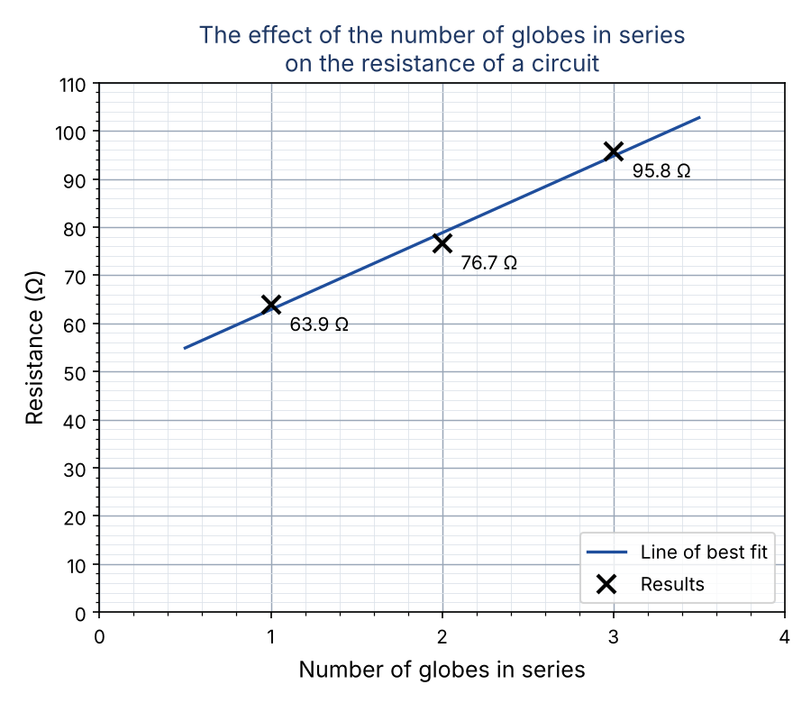

================================================
Step 4. Results and Graph
================================================

Part B: Collection of Data

Question 8: Results table and resistance
------------------------------------------------

.. admonition:: Question 8
    :class: important

    For the different conditions of your independent variable in the first column, enter your measured values
    for current and voltage in the table, then calculate the resistance (R = V ÷ I). Show working out.

.. admonition:: Key ideas
    :class: note

    * The **independent variable** goes in the **first column**.
    * **Units** go in the column headings, not after every number.
    * **R = V ÷ I**: divide the voltage by the current.
    * Round each resistance to **one decimal place**.

.. list-table::
   :widths: 25 20 20 35
   :header-rows: 1

   * - Number of globes in series
     - Voltage (V)
     - Current (A)
     - Resistance (Ω)
   * - 1
     - 11.5
     - 0.18
     - 11.5 ÷ 0.18 = 63.9
   * - 2
     - 11.5
     - 0.15
     - 11.5 ÷ 0.15 = 76.7
   * - 3
     - 11.5
     - 0.12
     - 11.5 ÷ 0.12 = 95.8

.. admonition:: Watch out
    :class: warning

    Divide the **voltage by the current**, not the current by the voltage.
    A quick check: with the same voltage, a **smaller** current must give a **larger** resistance.

Fill in the gaps: working out
~~~~~~~~~~~~~~~~~~~~~~~~~~~~~~~

.. cloze::
    :instructions: Drag each number from the bank into the correct gap to complete the working out. Each number is used once.

    1 globe:   R = V ÷ I = @@11.5@@ ÷ 0.18 = @@63.9@@ Ω
    2 globes:  R = V ÷ I = 11.5 ÷ @@0.15@@ = @@76.7@@ Ω
    3 globes:  R = V ÷ I = 11.5 ÷ @@0.12@@ = @@95.8@@ Ω

Fill in the gaps: reading the table
~~~~~~~~~~~~~~~~~~~~~~~~~~~~~~~~~~~~~

.. cloze::
    :instructions: Drag each word from the word bank into the correct gap. Each word is used once.

    1. The number of globes goes in the @@first@@ column because it is the independent variable.
    2. The units are written in the column @@headings@@.
    3. Resistance is calculated by dividing the @@voltage@@ by the @@current@@.
    4. The voltage stayed @@constant@@ at 11.5 V for every condition.
    5. As more globes were added, the current @@decreased@@ and the resistance @@increased@@.

Question 9: Graph
------------------------------------------------

.. admonition:: Question 9
    :class: important

    On the grid:

    * Plot the values of resistance on the y-axis and the corresponding value of your independent variable on the x-axis.
    * Use a line graph if your independent variable is quantitative, or a column graph if it is qualitative.
    * Label both axes with titles and units if applicable.
    * Include an appropriate title.

.. admonition:: Key ideas
    :class: note

    * The **independent variable** goes on the **x-axis** (horizontal).
    * The **dependent variable** goes on the **y-axis** (vertical).
    * The number of globes is **quantitative** (it is a number), so a **line graph** is used.
    * Each axis needs a **label** and a **unit** (if it has one), and an **even scale**.
    * Plot each point with a small **cross**, then rule a **line of best fit**.
    * The **title** names both variables.

| Points to plot: (1, 63.9), (2, 76.7), (3, 95.8)

Fill in the gaps
~~~~~~~~~~~~~~~~~~~~~~

.. cloze::
    :instructions: Drag each word from the word bank into the correct gap. Each word is used once.

    1. The number of globes in series is plotted on the @@x-axis@@ because it is the independent variable.
    2. Resistance is plotted on the @@y-axis@@ because it is the dependent variable.
    3. A @@line@@ graph is used because the number of globes is a @@quantitative@@ variable.
    4. The y-axis label includes the unit, which is the @@ohm@@.
    5. Each axis has an even @@scale@@ so that the points are plotted accurately.
    6. A line of best @@fit@@ is ruled as close as possible to all of the points.

Fill in the gaps: title
~~~~~~~~~~~~~~~~~~~~~~~~~

.. cloze::
    :instructions: Drag each word from the word bank into the correct gap to build the graph title. Each word is used once.

    The @@effect@@ of the @@number@@ of globes in @@series@@ on the @@resistance@@ of a circuit
